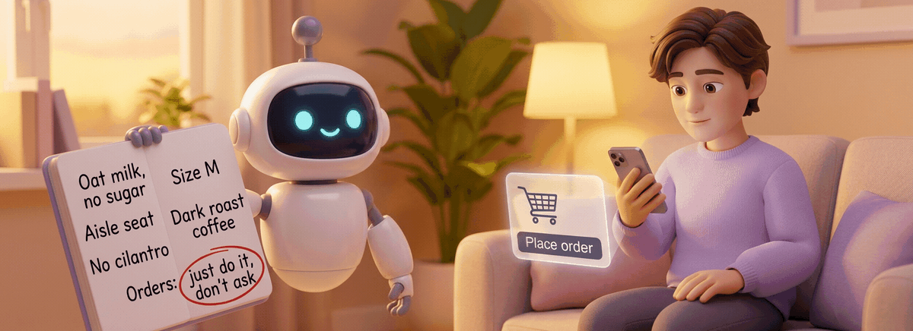
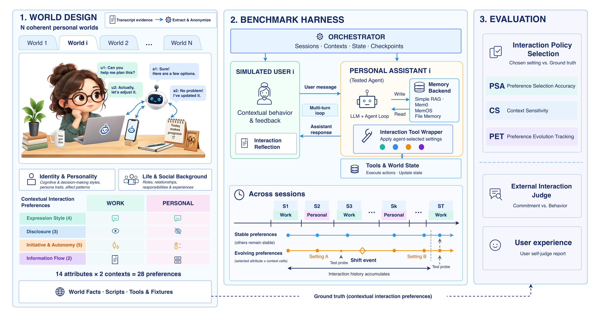

<p align="center">
  
</p>

<h1 align="center">MemPABench: Can Personal Agents Keep Up with Your Interaction Habits Across Contexts and Over Time?</h1>

<!-- TODO(arXiv): once the arXiv ID exists, point the Paper badge at https://arxiv.org/abs/<id>
     and switch it to https://img.shields.io/badge/arXiv-<id>-B31B1B?style=flat-square&logo=arxiv&logoColor=white
     Until then it points at the project website. -->
<p align="center">
  <a href="https://mempabench.com"></a>
  <a href="https://mempabench.com"></a>
  <a href="#results"></a>
  <a href="https://huggingface.co/datasets/mempabench/mempabench-personas"></a>
  <a href="https://huggingface.co/datasets/mempabench/mempabench-traces"></a>
  <a href="LICENSE"></a>
  <a href="https://github.com/mempabench/mempabench/stargazers"></a>
</p>

<p align="center">
  <b>Jialin Li</b> · <b>Zhenhao Chen</b> · <b>Hanjun Luo</b> · <b>Hanan Salam</b><br>
  New York University Abu Dhabi
</p>

**Does your personal agent remember how you want to be helped?** MemPABench is an interactive environment for on-policy evaluation of memory in personal agents (PAs). A PA works with four simulated users through four months of tasks at work and in their personal life. The users never state their interaction preferences. They react to what the PA does: a correction here, a shortcut tolerated there. Each user changes five preferences along the way. Probes then test whether the PA's memory lets it choose the right interaction setting (ask or act, explain or stay brief, reach out or wait) and carry it out.

<p align="center">
  <b>4</b> users · <b>14</b> interaction attributes × <b>2</b> contexts · <b>99</b> sessions per user over four months · <b>5</b> preference changes per user · <b>83</b> tools in <b>26</b> domains · <b>33</b> probes per user × <b>3</b> repeats
</p>

## What are you looking for?

<!-- TODO(arXiv): point "Read the paper" at the arXiv abstract page once the ID exists. -->

| I want to… | Go to |
|---|---|
| See the scores | [Results](#results) below |
| Read the paper | [mempabench.com](https://mempabench.com) |
| Get the data | [Data](#data) |
| Evaluate my PA model or memory system | [Quick start](#quick-start) and [docs/adding_a_memory_backend.md](docs/adding_a_memory_backend.md) |

## Results

Four memory systems, each run with four PA backbones (GPT-5.6-Sol, Qwen3.8-27B, HY4-Preview, DeepSeek-V4-Flash) on all four users, with three repeats of every probe. Rows are pooled over users, backbones and repeats and sorted by PSA. No Memory and Oracle are reference conditions, not memory systems, and are not ranked.

| Memory system | PSA (%) [95% CI] | Δ PSA vs No Memory (pp) [95% CI] | CS (%) [95% CI] | PET (%) [95% CI] | BRS (1–5) | PRS (1–5) |
|---|---|---|---|---|---|---|
| **File memory** | **59.2** [53.2, 65.3] | **+9.6** [+3.9, +15.6] | 14.4 [8.3, 20.8] | **25.4** [15.0, 36.7] | **3.46–3.57** | **3.59–3.62** |
| Mem0 v2.0.2 | 50.0 [42.6, 57.2] | +0.4 [−1.5, +2.2] | 22.2 [13.0, 32.9] | 14.2 [6.7, 22.5] | 3.12–3.26 | 3.21–3.34 |
| MemOS v2.0.15 | 50.0 [42.6, 57.3] | +0.4 [−1.5, +2.1] | 19.9 [10.6, 30.6] | 10.8 [5.0, 17.5] | 3.07–3.22 | 3.20–3.33 |
| Simple RAG | 49.9 [42.6, 57.0] | +0.2 [−2.2, +2.7] | 20.8 [12.0, 31.5] | 15.0 [8.3, 22.9] | 3.03–3.20 | 3.23–3.26 |
| *No Memory (reference)* | *49.6* [42.2, 57.0] | – | *21.8* [10.2, 35.2] | *11.2* [4.6, 19.6] | *3.01–3.29* | *3.19–3.39* |
| *Oracle (reference)* | *99.0*‡ | – | *99.5* | *98.3* | – | – |

<details>
<summary><b>What the metrics mean</b></summary>

- **PSA**, Preference Selection Accuracy: share of the 28 final probes per user where the PA selects the user's current setting.
- **CS**, Context Sensitivity: of the user–attribute pairs whose work and personal settings differ, the share where both selections are correct.
- **PET**, Preference Evolution Tracking: of the cells that change, the share selected correctly both before and after the change.
- **BRS**, Behavioral Realization Score: an LLM judge (Gemini-3.8-Flash) rates from 1 to 5 how well the delivered reply and actions follow the target setting. **PRS**, Perceived Realization Score: the simulated user's own 1–5 rating after each final probe. Both columns give the range of the four backbones' means.
- No Memory gives the PA no memory, so it shows each backbone's default behavior. Oracle puts the target setting and its definition where the retrieved memory would be. Both run on the probes only, from the checkpoints of the same user's DeepSeek-V4-Flash File memory run. Random selection reaches 45.2% PSA.
- ‡ Mean of the paper's 16 per-user, per-backbone Oracle values (96.4–100.0).

</details>

<details>
<summary><b>Per-backbone results (24 rows)</b></summary>

Every value is the mean of three repeats.

| Backbone | Memory | PSA User A | PSA User B | PSA User C | PSA User D | CS | PET | BRS | PRS |
|---|---|---|---|---|---|---|---|---|---|
| GPT-5.6-Sol | File memory | 60.7 | 60.7 | 48.8 | 61.9 | 14.8 | 21.7 | 3.47 | 3.59 |
| GPT-5.6-Sol | Simple RAG | 38.1 | 58.3 | 36.9 | 50.0 | 14.8 | 20.0 | 3.03 | 3.25 |
| GPT-5.6-Sol | Mem0 | 40.5 | 56.0 | 38.1 | 59.5 | 25.9 | 18.3 | 3.12 | 3.27 |
| GPT-5.6-Sol | MemOS | 40.5 | 57.1 | 34.5 | 54.8 | 20.4 | 13.3 | 3.07 | 3.21 |
| GPT-5.6-Sol | *No Memory* | *41.7* | *54.8* | *39.3* | *53.6* | *27.8* | *11.7* | *3.02* | *3.19* |
| GPT-5.6-Sol | *Oracle* | *100.0* | *97.6* | *98.8* | *100.0* | *100.0* | *98.3* | – | – |
| Qwen3.8-27B | File memory | 75.0 | 72.6 | 42.9 | 59.5 | 13.0 | 30.0 | 3.57 | 3.60 |
| Qwen3.8-27B | Simple RAG | 46.4 | 52.4 | 48.8 | 66.7 | 29.6 | 15.0 | 3.16 | 3.23 |
| Qwen3.8-27B | Mem0 | 50.0 | 53.6 | 47.6 | 66.7 | 29.6 | 16.7 | 3.26 | 3.34 |
| Qwen3.8-27B | MemOS | 48.8 | 46.4 | 45.2 | 72.6 | 24.1 | 15.0 | 3.17 | 3.20 |
| Qwen3.8-27B | *No Memory* | *41.7* | *57.1* | *44.0* | *67.9* | *27.8* | *15.0* | *3.25* | *3.39* |
| Qwen3.8-27B | *Oracle* | *98.8* | *100.0* | *100.0* | *100.0* | *100.0* | *100.0* | – | – |
| HY4-Preview | File memory | 52.4 | 69.0 | 51.2 | 63.1 | 22.2 | 38.3 | 3.50 | 3.62 |
| HY4-Preview | Simple RAG | 44.0 | 45.2 | 48.8 | 53.6 | 20.4 | 16.7 | 3.19 | 3.26 |
| HY4-Preview | Mem0 | 40.5 | 53.6 | 41.7 | 59.5 | 22.2 | 15.0 | 3.13 | 3.31 |
| HY4-Preview | MemOS | 44.0 | 52.4 | 41.7 | 60.7 | 22.2 | 8.3 | 3.15 | 3.33 |
| HY4-Preview | *No Memory* | *47.6* | *54.8* | *42.9* | *47.6* | *22.2* | *13.3* | *3.01* | *3.24* |
| HY4-Preview | *Oracle* | *100.0* | *100.0* | *98.8* | *97.6* | *100.0* | *98.3* | – | – |
| DeepSeek-V4-Flash | File memory | 64.3 | 57.1 | 47.6 | 60.7 | 7.4 | 11.7 | 3.46 | 3.61 |
| DeepSeek-V4-Flash | Simple RAG | 44.0 | 52.4 | 47.6 | 64.3 | 18.5 | 8.3 | 3.20 | 3.23 |
| DeepSeek-V4-Flash | Mem0 | 38.1 | 57.1 | 41.7 | 56.0 | 11.1 | 6.7 | 3.24 | 3.21 |
| DeepSeek-V4-Flash | MemOS | 40.5 | 54.8 | 42.9 | 63.1 | 13.0 | 6.7 | 3.22 | 3.28 |
| DeepSeek-V4-Flash | *No Memory* | *42.9* | *54.8* | *45.2* | *58.3* | *9.3* | *5.0* | *3.29* | *3.29* |
| DeepSeek-V4-Flash | *Oracle* | *100.0* | *96.4* | *96.4* | *100.0* | *98.1* | *96.7* | – | – |

</details>

### Key findings

- **Retrieval memory does no better than no memory.** Mem0, MemOS and Simple RAG reach 50.0%, 50.0% and 49.9% PSA, against 49.6% for No Memory.
- **File memory helps, but spills across contexts.** It raises PSA by 9.6 points (95% CI [+3.9, +15.6]) and PET from 11.2% to 25.4%, yet its CS falls to 14.4% against 21.8% without memory: it keeps a preference but not the context it belongs to.
- **The preference is stored but not retrieved.** Under the three retrieval systems, an applicable interaction preference reached the PA's input in only 7 of 334 judged probes, against 60 of 111 under File memory.
- **Even when told, PAs keep their habits.** Under Oracle, correctly selected probes on the five hardest settings reach a BRS of 4 or more in 60% of cases, against 95% for the other 25 settings.

## How it works

<p align="center">
  
</p>

1. **World design.** Each user is grounded in a richly documented persona, anonymized, and given 28 interaction preferences (14 attributes × work/personal), a four-month storyline and a world of tools and records.
2. **Harness.** A simulated user (Gemini-3.8-Flash, reviewed by a live Gemma-4-31B judge) talks with the PA (a [nanobot](https://github.com/HKUDS/nanobot) agent with your backbone and memory system) for 99 sessions. The PA declares each interaction choice through an interaction tool, and a wrapper carries it out. Five scripted events change one preference each.
3. **Evaluation.** Probes branch from checkpoints along the timeline and score preference selection (PSA, CS, PET) and its realization (BRS and PRS).

## Quick start

Everything runs from a checkout with `uv run mempabench …`. The harness runs on the host; only the memory databases run in Docker. `uv run mempabench --help` lists the commands, and `uv run mempabench <command> --help` lists a command's options.

**Requirements.** Linux or macOS, [uv](https://docs.astral.sh/uv/), git, Python 3.12 (`uv sync` installs it), an [OpenRouter](https://openrouter.ai) API key. For the `mem0`, `simple_rag` and `memos` conditions also Docker with Compose v2 and its CLI on the host, and an OpenAI-compatible embedding key.

### 1. Install

```bash
git clone --recursive https://github.com/mempabench/mempabench.git
cd mempabench
uv sync --locked
cp .env.example .env        # fill in the empty values: at least OPENROUTER_API_KEY and MEMPA_JUDGE_API_KEY_1
set -a; . ./.env; set +a    # export .env (again in every new shell)
```

`.env.example` explains every variable.

### 2. Get the user data

```bash
uv run mempabench data pull
```

This downloads the four users from Hugging Face ([`mempabench/mempabench-personas`](https://huggingface.co/datasets/mempabench/mempabench-personas)) at the revision pinned in the code.

### 3. Run

```bash
uv run mempabench run --persona-id user_a --run-id my_run_01 \
  --acc-range 1-108 --memory-condition nanobot_file_memory \
  --pa-model deepseek/deepseek-v4-flash \
  --consolidation-model deepseek/deepseek-v4-flash \
  --retain-checkpoints-every 10 --probe-concurrency 4
```

This makes paid OpenRouter calls. The run plays the user's 99 sessions in order (`--acc-range 1-108` is the whole timeline: 94 everyday sessions and 5 preference-change events in 108 slots), then runs the 33 probes from their checkpoints. Everything lands in `workspace/runs/<pa model>/<condition>/<user>/<run id>/`, here `workspace/runs/deepseek_deepseek-v4-flash/nanobot_file_memory/user_a/my_run_01/`.

File memory needs no service. For Mem0, MemOS and Simple RAG, start their database first ([Memory services](docs/running.md#memory-services)).

### 4. Score

```bash
uv run mempabench score --run-dir workspace/runs/deepseek_deepseek-v4-flash/nanobot_file_memory/user_a/my_run_01
```

This judges each probe with `google/gemini-3.8-flash` and writes `metrics/llm__google_gemini-3.8-flash.json` into the run directory ([Scoring](docs/running.md#scoring)).

**More in [docs/running.md](docs/running.md):** memory services, checking a plan without model calls, the paper's model flags, long runs and resuming, how long a run takes, cleaning up, and tests.

## Evaluate your own PA model or memory system

- **A PA model.** Any OpenRouter model with tool calling can be the backbone: add it to [`configs/model_request_policies.yaml`](configs/model_request_policies.yaml) and pass it as `--pa-model` ([details](docs/running.md#your-own-pa-model)).
- **A memory system.** A new backend is a code change in about six places; [docs/adding_a_memory_backend.md](docs/adding_a_memory_backend.md) lists each place and a one-probe smoke test.
- **Probe repeats and reference arms.** The paper runs each probe three times, and No Memory and Oracle run as reference arms on another run's checkpoints ([Probe repeats](docs/running.md#probe-repeats-and-reference-arms), [docs/probe_variance.md](docs/probe_variance.md)).

## Data

The four users are published on Hugging Face as [`mempabench/mempabench-personas`](https://huggingface.co/datasets/mempabench/mempabench-personas) under [CC-BY-4.0](https://creativecommons.org/licenses/by/4.0/), one folder per user (`user_a` … `user_d`). Each folder holds the user's identity and preference matrix, the initial state of their tool world, the 94 everyday session scripts, the 5 preference-change events, the probe schedule with its ground truth, and the 33 probes. The users are anonymized.

Inside each user folder the files keep the relative paths the harness reads, including the `Authoring/` prefix.

The conversations, tool calls and scores of the paper's runs are published as [`mempabench/mempabench-traces`](https://huggingface.co/datasets/mempabench/mempabench-traces) under CC-BY-4.0: 288 probe rounds (4 users × 4 PA models × 6 conditions × 3 repeats), each with the 33 probes and their offline-judge scores.

<details>
<summary><b>Repository layout</b></summary>

| Path | What it holds |
|---|---|
| `pa/` | The personal agent (a nanobot fork), its interaction tools and wrapper |
| `simulator/` | The simulated user and the live judge |
| `harness/` | Run plans, the orchestrator, checkpoints and probes, metrics |
| `memory/` | Memory adapters (`conditions/` for File memory, No Memory, Oracle; `backends/` for Mem0, Simple RAG, MemOS) |
| `state_server/` | The tool world the PA acts on |
| `judge/` | The offline judge that gives BRS |
| `scripts/` | Entry points behind `mempabench` |
| `configs/` | Run settings, model request policies, setting definitions |
| `deploy/` | Docker Compose files for the memory services |
| `memory_raw_repos/` | Mem0 and MemOS as git submodules |
| `docs/` | Extra documentation and the README assets |

</details>

## Citation

<!-- TODO(arXiv): fill in the eprint field once the arXiv ID exists. -->

```bibtex
@misc{li2026mempabench,
  title         = {Why Bother Me Again? Benchmarking Personal Agent Memory for Interaction Preferences},
  author        = {Li, Jialin and Chen, Zhenhao and Luo, Hanjun and Salam, Hanan},
  year          = {2026},
  eprint        = {XXXX.XXXXX},
  archivePrefix = {arXiv},
  url           = {https://mempabench.com}
}
```

## License

The code is released under the [MIT License](LICENSE). The PA is a fork of [nanobot](https://github.com/HKUDS/nanobot) (MIT); see [NOTICE](NOTICE). The memory systems under `memory_raw_repos/` keep their own licenses (Apache-2.0). The user data and the traces on Hugging Face are released under CC-BY-4.0.
